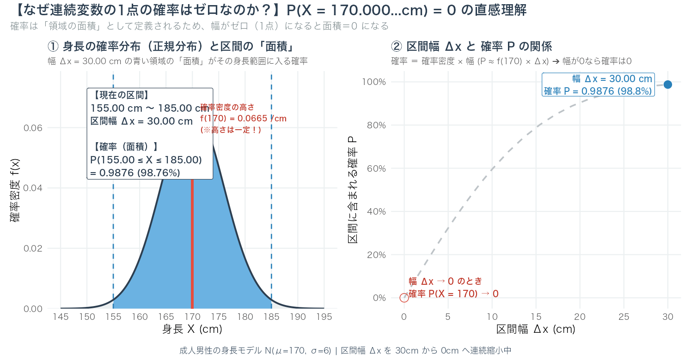

```{r setup, include=FALSE}
suppressPackageStartupMessages({
  library(ggplot2)
  library(dplyr)
  library(tidyr)
  library(patchwork)
})
font_family <- "Hiragino Sans"
```

## はじめに：日常の直感と数学のギャップ

「日本人の成人男性で、身長170cmの人なんて街中にいくらでもいるじゃないか。それなのに**『身長が170cmである確率は 0 である（$P(X = 170) = 0$）』**と言われるのはなぜ？」

統計学や確率論を学ぶとき、多くの人がこの**「連続変数の確率ゼロ問題」**に強い違和感を覚えます。

::: {.callout-important appearance="simple"}
### 🧭 違和感の正体：日常の「170cm」と数学の「170cm」の違い
- **日常の「170cm」**: 「測定機器の精度（有効数字）」を前提とした**『区間（幅）』**の話。
  - 身長計が170cmと表示するのは、実際には **$169.5\text{cm} \le X < 170.5\text{cm}$（幅 1cm の範囲）** に入っていることを意味します。この区間に入る確率は **約 $6.6\%$** 存在します。
- **数学の「170cm」**: 小数点以下が無限に続く**『幅ゼロの1点』**の話。
  - $170.00000000000000000000\dots\text{cm}$ に**ナノメートル・原子レベルまで完全に一致する確率**を計算すると、数学的に **$0$** になります。
:::

---

## 幾何学的な直感アナロジー（幾何学的確率）

なぜ「幅がゼロの1点」の確率は 0 になるのか、身近な幾何学の例で考えてみましょう。

### 1. ダーツの的当て
面積が $100\text{cm}^2$ のダーツボードに、ダーツの針が必ずどこか1点に刺さるとします。

- 「右半分のエリア（面積 $50\text{cm}^2$）に刺さる確率」 $\to \frac{50}{100} = 50\%$
- 「中心の小さな丸（面積 $1\text{cm}^2$）に刺さる確率」 $\to \frac{1}{100} = 1\%$
- **「幾何学的に指定した特定の1点（座標 $(x_0, y_0)$）にドンピシャで刺さる確率」**:
  - 幾何学的な「点」には**面積がありません（面積 $= 0$）**。
  - したがって、確率は $\frac{0}{100} = 0\%$ となります。

ダーツは**絶対にどこかの点に刺さっている**にもかかわらず、**「その指定された点に刺さる確率」は $0$** なのです。

### 2. 糸を切る実験
長さ $10\text{cm}$ の糸をランダムな位置でハサミで切るとき、ピッタリ $5.000000\dots\text{cm}$ で切れる確率は何％でしょうか？
$0$ から $10$ までの間には実数が**無限個（非可算無限）**存在するため、特定の実数を言い当てる確率は $\frac{1}{\infty} \to 0$ です。

---

## 動的ビジュアライゼーション（gganimate による極限の可視化）

成人男性の身長分布（平均 $\mu = 170\text{cm}$、標準偏差 $\sigma = 6\text{cm}$ の正規分布）を用いて、**区間の幅 $\Delta x$ を徐々に狭めていったときに面積（確率）がどう変化するか**をアニメーションで見てみましょう。



### アニメーションからわかる決定的な事実

1. **確率密度（グラフの高さ）は一定のまま！**
   - 身長 $170\text{cm}$ における確率密度関数の高さは $f(170) \approx 0.0665$ であり、ゼロではありません。
2. **しかし、幅 $\Delta x$ が狭くなるにつれて「面積（確率）」がゼロへ収縮する！**
   - **幅 $20\text{cm}$**（$160 \sim 180\text{cm}$）: 確率 $\approx 90.44\%$
   - **幅 $2\text{cm}$**（$169 \sim 171\text{cm}$）: 確率 $\approx 13.23\%$
   - **幅 $0.2\text{cm}$**（$169.9 \sim 170.1\text{cm}$）: 確率 $\approx 1.33\%$
   - **幅 $0\text{cm}$**（ピッタリ $170.000\dots\text{cm}$）:
     $$\text{確率 } P(X = 170) = \text{底辺（幅 0）} \times \text{高さ } f(170) = 0 \times 0.0665 = \mathbf{0}$$

::: {.callout-tip}
### 💡 核心の公式
連続型確率変数において、微小幅 $\Delta x$ における確率は以下のように近似されます：
$$P\left(x - \frac{\Delta x}{2} \le X \le x + \frac{\Delta x}{2}\right) \approx f(x) \times \Delta x$$
$\Delta x \to 0$ の極限をとると、$f(x)$ がどんな値であっても右辺は必ず $0$ になります。
:::

---

## 「確率（Probability）」と「確率密度（Probability Density）」の比較

この混乱を解消するためには、「確率」と「確率密度」の違いを明確に区別することが不可欠です。

| 比較項目 | 確率（Probability） | 確率密度（Probability Density） |
| :--- | :--- | :--- |
| **記号** | $P(a \le X \le b)$ | $f(x)$ |
| **図形的な意味** | 曲線の下の **「面積」**（積分値） | 曲線上の特定地点の **「高さ」** |
| **計算式** | $P(a \le X \le b) = \int_a^b f(x) dx$ | $f(x) = \lim_{\Delta x \to 0} \frac{P(x \le X \le x+\Delta x)}{\Delta x}$ |
| **値の範囲** | **必ず $0 \le P \le 1$**（$0\% \sim 100\%$） | **$0 \le f(x) < \infty$**（**$1$ を超えてもよい！**） |
| **単位（次元）** | **無次元**（割合・パーセント） | **$[1 / \text{変数の単位}]$**（例: $1/\text{cm}$, $1/\text{kg}$） |
| **1点での値** | 常に **$P(X = x) = 0$** | **$f(x) \ge 0$**（有限の正の値） |

### 確率密度が 1 を超える具体例

「確率密度」は確率そのものではなく「単位長さあたりの密度」であるため、$1$ を超えることが多々あります。

例えば、非常に精密なネジの長さが $N(\mu = 10\text{mm}, \sigma = 0.05\text{mm})$ に従う場合：

```{r}
# 標準偏差が小さい場合の確率密度
sigma_small <- 0.05
f_peak <- dnorm(10, mean = 10, sd = sigma_small)
cat(sprintf("中心 x = 10mm における確率密度の高さ: f(10) = %.2f (1 を大幅に超過！)\n", f_peak))
```

高さは約 $7.98$ にも達しますが、幅 $0.01\text{mm}$ の微小面積を計算すると $7.98 \times 0.01 \approx 0.0798$（約 $8\%$）となり、確率は必ず $1$ 以下に収まります。

---

## 「確率ゼロ」は「絶対に起きない（不可能）」を意味するのか？

これは確率論・測度論における最も深遠なテーマの1つです。

::: {.callout-note appearance="simple"}
### 🚨 結論：「確率 0 の事象」でも実際に発生する！
- **不可能な事象（空集合 $\emptyset$）** の確率は必ず $0$ です（例: サイコロを振って 7 が出る確率 $= 0$）。
- しかし、その逆は成り立ちません。**「確率が $0$ だからといって、絶対に起こらないわけではない」**のです。
:::

### 測度論における「ほとんど確実に（Almost Surely）」

ランダムに身長を測定したとき、測定された人の身長は（仮に超高精度のレーザーで測れば）$170.238491029\dots\text{cm}$ のような何らかの実数になります。

- 測定される**前**の段階で、「その人がピッタリ $170.238491029\dots\text{cm}$ である確率」を計算すると **$0$** です。
- にもかかわらず、測定した**後**には**「確率 $0$ の事象」が実際に目の前で起こった**ことになります。

このように、連続空間では「確率ゼロの事象の無限の集まり」によって全体（確率 1）が構成されています。数学ではこの性質を**「ほとんど確実に（almost surely / a.s.）」**と呼びます。

---

## R による数値実験シミュレーション

コンピュータの乱数を用いて、この事実をシミュレーションしてみましょう。

```{r}
# 100万人分の成人男性の身長データを生成 (μ = 170, σ = 6)
set.seed(42)
n_people <- 1000000
heights <- rnorm(n_people, mean = 170, sd = 6)

# 実験1: ピッタリ 170.00000000000000 cm の人は何人いるか？
exact_170 <- sum(heights == 170.0)
cat(sprintf("【実験1】100万人中、ピッタリ 170.000...cm だった人数: %d 人 (割合: %.6f%%)\n", 
            exact_170, (exact_170 / n_people) * 100))

# 実験2: 通常の身長計の精度 (169.5cm 〜 170.5cm) に入る人は何人いるか？
range_170 <- sum(heights >= 169.5 & heights < 170.5)
theo_prob <- pnorm(170.5, mean = 170, sd = 6) - pnorm(169.5, mean = 170, sd = 6)

cat(sprintf("【実験2】100万人中、169.5cm〜170.5cm に入った人数: %d 人 (割合: %.2f%%)\n", 
            range_170, (range_170 / n_people) * 100))
cat(sprintf("         理論値 (pnorm による積分面積)          : %.2f%%\n", theo_prob * 100))
```

100万人分のデータを集めても、コンピュータの倍精度浮動小数点でピッタリ $170.000\dots$ になる人は**0人**でした。一方、幅 $1\text{cm}$ の区間には約 $6.6$ 万人（$6.6\%$）が綺麗に収まっています。

---

## 連続型確率変数における重要な性質：不等号の「$\le$」と「$<$」

離散型確率変数（サイコロの目など）では、$P(X \le 3)$ と $P(X < 3)$ は異なります（$P(X=3)$ の分だけズレる）。

しかし、**連続型確率変数では $P(X = c) = 0$ であるため、イコール（等号）の有無で確率が変わりません**。

$$P(a \le X \le b) = P(a < X \le b) = P(a \le X < b) = P(a < X < b)$$

境界線となる1点の面積は常に $0$ だからこそ、端点を含めても含めなくても積分面積は完全に一致します。

---

## 理解度チェッククイズ

::: {.callout-caution collapse="true"}
### ❓ 第1問：連続型確率変数 $X$ の確率密度関数 $f(x)$ について、$f(170) = 0.0665$ であるとき、$P(X = 170) = 0.0665$ と言えるか？
**【解答】**
**言えません（誤り）**。
$f(170) = 0.0665$ はあくまで確率密度の「高さ」であり、確率は「面積」です。一点における幅は $0$ なので、確率 $P(X = 170) = 0$ となります。
:::

::: {.callout-caution collapse="true"}
### ❓ 第2問：一様分布 $U(0, 10)$（0から10まで均等に発生する乱数）において、$P(X = 5)$ と $P(4.9 \le X \le 5.1)$ はそれぞれいくらか？
**【解答】**
- $P(X = 5) = \mathbf{0}$
- $P(4.9 \le X \le 5.1) = \text{幅 } (5.1 - 4.9) \times \text{高さ } \frac{1}{10} = 0.2 \times 0.1 = \mathbf{0.02} \ (2\%)$
:::

::: {.callout-caution collapse="true"}
### ❓ 第3問：「確率が 0 の事象」と「空集合（不可能な事象）」の違いは何か？
**【解答】**
- **空集合（不可能な事象）**: 定義上絶対に起こり得ない事象（例: 偶数の奇数、コインを投げてサイコロの目が出るなど）。その確率は必ず $0$。
- **確率が 0 の事象**: 起こり得る事象であっても、連続空間の一点のように測度（面積や体積）が $0$ である事象。ランダムに選ばれた値そのものは、選ばれる前の確率としては $0$ ですが、実際に発生します。
:::

---

## まとめ

1. **日常の「170cm」**は測定精度の幅（$169.5 \sim 170.5\text{cm}$）を指しており、面積（確率 $\approx 6.6\%$）を持つ。
2. **数学の「170cm」**は幅ゼロの1点（$170.000\dots\text{cm}$）を指しており、幅がゼロなので面積（確率）は必ず $0$ になる。
3. **確率密度 $f(x)$** は「高さ」であり、確率は常に微小幅を掛けた「面積（$\int f(x) dx$）」として計算される。
4. **「確率がゼロ」は「起こり得ない」と同義ではない**。連続空間では確率ゼロの事象が実際に発生する。
