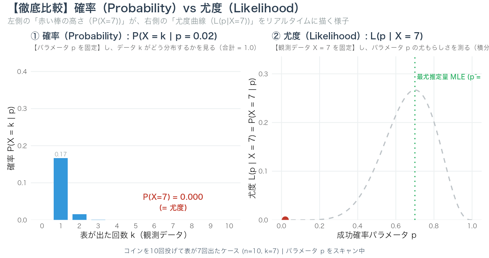
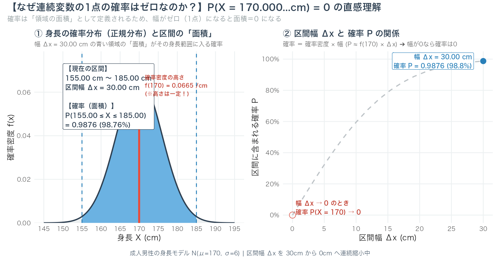
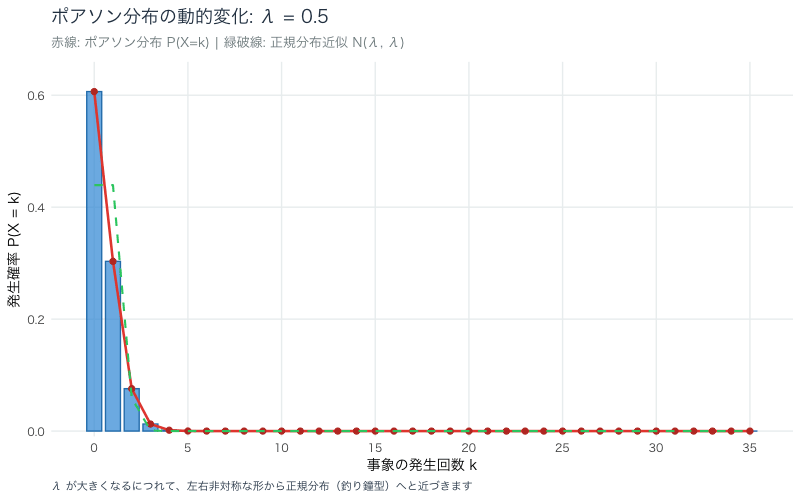
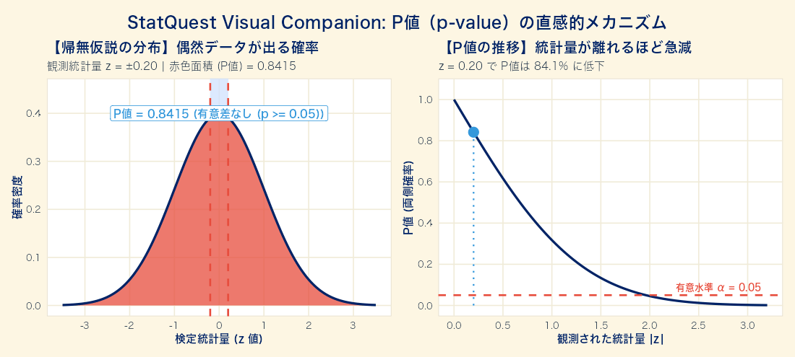

::: {.callout-note appearance="simple"}
### 🎯 StatQuest 補助教材ポータルへようこそ！
世界中で大絶賛されている統計学習チャンネル **「StatQuest with Josh Starmer」** の名講義をベースに、**R 言語**と **`gganimate`** による動的アニメーション・シミュレーションコードを組み合わせたインタラクティブ教材集です。各トピックの「教材を開く」ボタンから、GitHub Pages でレンダリングされたフルドキュメントを閲覧できます。
:::

---

## 📚 収録教材一覧（Interactive Guides）

::: {.grid}

::: {.g-col-12 .g-col-md-6}
::: {.portal-card}
{.portal-card-img}

<span class="portal-badge">Topic 01 ・ 基礎概念</span>

### 確率 vs 尤度
**Probability vs Likelihood**

- **StatQuest**: *Probability vs Likelihood*
- **核心**: 「前提からデータを語る（確率）」vs「データから前提を推定する（尤度）」。パラメータ変化に伴い確率分布の高さが尤度曲線を描く瞬間をアニメーション化。
- **キーワード**: 順問題・逆問題、最尤推定量 (MLE)、対数尤度、ベイズの定理

<a href="topics/01_probability_vs_likelihood/probability_vs_likelihood_guide.html" class="btn-portal">📖 教材を開く (GitHub Pages)</a>
:::
:::

::: {.g-col-12 .g-col-md-6}
::: {.portal-card}
{.portal-card-img}

<span class="portal-badge">Topic 02 ・ 基礎概念</span>

### 連続変数の確率ゼロ
**Why P(X = 170) = 0?**

- **StatQuest**: *Probability vs Probability Density*
- **核心**: 「身長170cmの人は大勢いるのに、なぜ数学的には確率ゼロなのか？」。日常の有効数字（幅）と数学の極限（幅ゼロ）の違い、確率密度（高さ）と確率（面積）の関係を動的可視化。
- **キーワード**: 確率密度関数 (PDF)、極限 $\Delta x \to 0$、測度論、almost surely

<a href="topics/02_continuous_probability_zero/continuous_probability_zero_guide.html" class="btn-portal">📖 教材を開く (GitHub Pages)</a>
:::
:::

::: {.g-col-12 .g-col-md-6}
::: {.portal-card}
{.portal-card-img}

<span class="portal-badge">Topic 03 ・ 確率分布</span>

### ポアソン分布 & 指数分布
**Poisson & Exponential**

- **StatQuest**: *Poisson Distribution & Exponential Distribution*
- **核心**: 「一定時間内の発生回数（ポアソン）」と「次の事象までの待ち時間（指数）」。表裏一体の関係にある2つの分布をシミュレーションとアニメーションで解説。
- **キーワード**: ポアソン過程、無記憶性、期待値と分散の一致、稀な事象

<a href="topics/03_poisson_distribution/poisson_guide.html" class="btn-portal">📖 教材を開く (GitHub Pages)</a>
:::
:::

::: {.g-col-12 .g-col-md-6}
::: {.portal-card}
{.portal-card-img}

<span class="portal-badge">Topic 04 ・ 基礎概念 & 検定</span>

### P値（p-value）の本質
**p-values Clearly Explained**

- **StatQuest**: *p-values: What they are and how to interpret them*
- **核心**: 「もし何の差もない世界だとしたら、これほど極端なデータが偶然出る確率はどれくらい奇跡的か？」。統計量の変化に伴いP値の裾野面積が急減しα=0.05を突破する動的アニメーションとシミュレーション。
- **キーワード**: 帰無仮説、片側・両側検定、t検定、モンテカルロ法、効果量と検察官の誤謬

<a href="topics/04_p_value/p_value_guide.html" class="btn-portal">📖 教材を開く (GitHub Pages)</a>
:::
:::

:::

---

## 🌐 GitHub Pages クイックリンクリスト

各教材のレンダリング済み HTML ページへのダイレクトリンク一覧です：

| # | トピック | GitHub Pages オンラインリンク | 対応スクリプト / GIF |
| :---: | :--- | :--- | :--- |
| **01** | **確率（Probability）vs 尤度（Likelihood）** | 🔗 [**解説ドキュメント (HTML)**](https://chess-r-quarto.github.io/R-scripts/topics/01_probability_vs_likelihood/probability_vs_likelihood_guide.html) | [アニメーション R](topics/01_probability_vs_likelihood/probability_vs_likelihood_anim.R) / [GIF](topics/01_probability_vs_likelihood/probability_vs_likelihood.gif) |
| **02** | **連続変数の確率ゼロ（$P(X=170)=0$）** | 🔗 [**解説ドキュメント (HTML)**](https://chess-r-quarto.github.io/R-scripts/topics/02_continuous_probability_zero/continuous_probability_zero_guide.html) | [アニメーション R](topics/02_continuous_probability_zero/continuous_probability_zero_anim.R) / [GIF](topics/02_continuous_probability_zero/continuous_probability_zero.gif) |
| **03** | **ポアソン分布と到着間隔（指数分布）** | 🔗 [**解説ドキュメント (HTML)**](https://chess-r-quarto.github.io/R-scripts/topics/03_poisson_distribution/poisson_guide.html) | [アニメーション R](topics/03_poisson_distribution/poisson_animation.R) / [GIF](topics/03_poisson_distribution/poisson_animation.gif) |
| **04** | **P値（p-value）の本質と仮説検定** | 🔗 [**解説ドキュメント (HTML)**](https://chess-r-quarto.github.io/R-scripts/topics/04_p_value/p_value_guide.html) | [アニメーション R](topics/04_p_value/p_value_anim.R) / [GIF](topics/04_p_value/p_value.gif) |

---

## 🔮 今後の追加予定カリキュラム（StatQuest シリーズ）

- 🔄 **単回帰分析と最小二乗法** (*Linear Models and Least Squares*)
- 🔄 **中心極限定理の動的シミュレーション** (*The Central Limit Theorem*)
- 🔄 **ロジスティック回帰とオッズ比** (*Logistic Regression*)
- 🔄 **主成分分析 (PCA) の幾何学的直感** (*Principal Component Analysis*)
- 🔄 **ROC曲線とAUCの直感理解** (*ROC and AUC, Clearly Explained!*)

---

## 🛠️ ソースコードとローカル実行

すべての教材ソース（Quarto QMD）およびアニメーション生成スクリプト（R）は [GitHub リポジトリ](https://github.com/chess-r-quarto/R-scripts) で管理されています。

```bash
# リポジトリのクローン
git clone https://github.com/chess-r-quarto/R-scripts.git

# サイト全体のビルド
quarto render

# ローカルプレビューサーバーの起動
quarto preview
```
