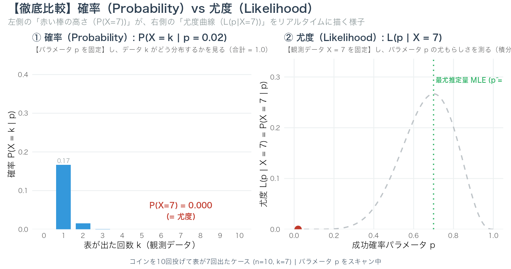
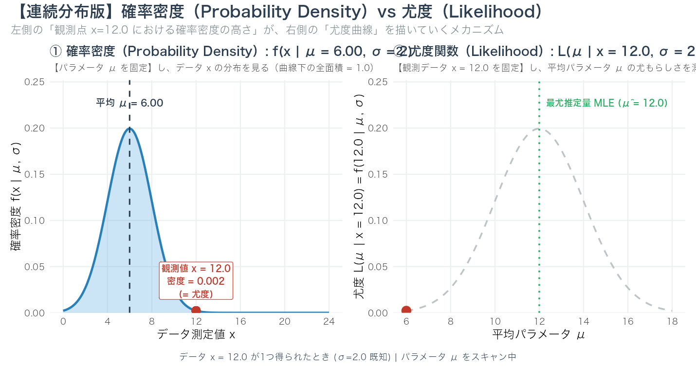

```{r setup, include=FALSE}
suppressPackageStartupMessages({
  library(ggplot2)
  library(dplyr)
  library(tidyr)
  library(patchwork)
})
font_family <- "Hiragino Sans"
```

## はじめに：なぜ「確率」と「尤度」は混乱するのか？

統計学や機械学習を学び始めると、必ずぶつかる壁が**「確率（Probability）」と「尤度（Likelihood：ゆうど）」の違い**です。

日常会話において、この2つの言葉はほぼ同じ意味（「確からしさ」や「可能性」）で使われます。しかし、**統計学の世界では全く異なる数学的対象**であり、視点（アプローチ）が真逆です。

::: {.callout-important appearance="simple"}
### 🧭 核心となる一言要約
- **確率（Probability）**: **「前提（パラメータ $\theta$）が分かっているとき、どんなデータ $x$ が得られるか？」**を語る指標（**順問題 / 未来予測**）
- **尤度（Likelihood）**: **「得られたデータ $x$ が分かっているとき、どの前提（パラメータ $\theta$）がもっともらしいか？」**を語る指標（**逆問題 / 原因推定**）
:::

---

## 決定的な違いの比較表

両者の根本的な違いを一覧表で整理します。

| 比較項目 | 確率（Probability） | 尤度（Likelihood） |
| :--- | :--- | :--- |
| **数式表現** | $P(X = x \mid \theta)$ | $L(\theta \mid x) = P(X = x \mid \theta)$ |
| **何が固定（既知）か？** | **パラメータ $\theta$**（母数・コインの性質など） | **観測データ $x$**（標本・実験結果） |
| **何が変数（動くもの）か？** | **データ $X$**（起こりうるすべての事象） | **パラメータ $\theta$**（推定したい候補値） |
| **合計 / 積分の値** | すべての事象を足すと **必ず $1$（$100\%$）** | 全パラメータで積分しても **$1$ にはならない** |
| **グラフの種類** | **確率分布**（横軸: データ $x$） | **尤度関数**（横軸: パラメータ $\theta$） |
| **時間のイメージ** | **未来の予測**（コインを投げる前） | **過去の解釈・原因推定**（コインを投げた後） |
| **代表的な問い** | 「歪みのないコイン（$p=0.5$）を10回投げたら、表が7回出る確率は？」 | 「コインを10回投げたら表が7回出た。このコインの表が出る確率 $p$ はいくつか？」 |

::: {.callout-note}
### ⚠️ 尤度は「確率」ではない！
数式上は $L(\theta \mid x) = P(X = x \mid \theta)$ と同じ計算式を使いますが、**「何を変数として見ているか」**が異なります。
尤度 $L(\theta \mid x)$ はパラメータ $\theta$ の関数であり、$\int L(\theta \mid x) d\theta = 1$ にはなりません。したがって、**「パラメータが $\theta$ である確率」とは呼べず、「尤もらしさ（Likelihood）」**と呼びます。
:::

---

## 動的ビジュアライゼーション（gganimate による直感理解）

両者の関係性を最も直感的に理解できるのが、**「確率分布の棒の高さが、リアルタイムに尤度曲線を描いていく」**アニメーションです。

### 離散型モデル：コイン投げ（二項分布 $n=10, k=7$）

「コインを10回投げたら表が7回出た（$k=7$）」という状況を考えます。

- **左側【確率の視点】**: コインの歪みパラメータ $p$（表が出る確率）を $0.05 \to 0.95$ へスキャンしたとき、確率分布全体の形が動きます。その中で**「観測された $k=7$」の赤い棒の高さ**に注目してください。
- **右側【尤度の視点】**: 左側で変化する「$k=7$ の棒の高さ」を拾い集め、横軸をパラメータ $p$、縦軸を尤度としてプロットしたものが右側の赤い曲線です。



#### アニメーションからわかる重要なポイント
1. **左の赤い棒の高さ ＝ 右の赤い点の高さ**: 
   どの瞬間（どの $p$）においても、左側の $P(X=7 \mid p)$ の値が、そのまま右側の尤度 $L(p \mid X=7)$ の値になっています。
2. **最尤推定量（MLE: Maximum Likelihood Estimator）**:
   パラメータ $p = 0.70$ の瞬間に、左側の $k=7$ の棒が最も高くなり、右側の尤度関数の山頂（最大値 $\approx 0.267$）に到達します。これが**「最尤法（もっとも観測データを生じやすいパラメータを選ぶ手法）」**です。
3. **合計値の違い**:
   - 左側はどの瞬間も、青い棒＋赤い棒の合計は常に $1.0$（$100\%$）です。
   - 右側の赤い曲線の下側の面積（積分値）は $\frac{1}{11} \approx 0.0909$ であり、$1.0$ にはなりません。

---

### 連続型モデル：製品の重量測定（正規分布 $x = 12.0\text{g}, \sigma = 2.0$）

連続値（身長、体重、測定値など）の場合、特定の一点が得られる確率は数学的に $0$ になります。そのため、確率密度の「高さ（確率密度関数 $f(x)$ の値）」を尤度として用います。

- **左側【確率密度の視点】**: 平均パラメータ $\mu$ が動くにつれて、正規分布の釣鐘型が左右に移動します。固定された観測点 $x = 12.0$ における垂線の高さ（密度）が上下します。
- **右側【尤度関数の視点】**: その垂線の高さを $\mu$ に対してプロットしたものが右側の尤度曲線です。



---

## 数式と理論計算（Rコードでの実践）

### 1. 二項分布における計算

コインを $n = 10$ 回投げて表が $k$ 回出る確率質量関数（PMF）は以下で表されます。

$$P(X = k \mid p) = \binom{n}{k} p^k (1-p)^{n-k}$$

#### 確率の計算（$p = 0.5$ を固定）
「公平なコイン（$p=0.5$）を10回投げて表が7回出る確率」：
$$P(X = 7 \mid p = 0.5) = \binom{10}{7} (0.5)^7 (0.5)^3 = 120 \times \frac{1}{1024} \approx 0.1172$$

```{r}
# 確率の計算 (p = 0.5 固定)
prob_k7 <- dbinom(7, size = 10, prob = 0.5)
cat(sprintf("P(X = 7 | p = 0.5) = %.4f (約 %.2f%%)\n", prob_k7, prob_k7 * 100))

# 確率の合計は 1 になるか？
sum_probs <- sum(dbinom(0:10, size = 10, prob = 0.5))
cat(sprintf("k=0..10 の確率合計 = %.1f\n", sum_probs))
```

#### 尤度の計算（$k = 7$ を固定）
「表が7回出たとき、コインのパラメータが $p = 0.5$ や $p = 0.7$ である尤度」：
$$L(p = 0.5 \mid X = 7) = P(X = 7 \mid p = 0.5) \approx 0.1172$$
$$L(p = 0.7 \mid X = 7) = P(X = 7 \mid p = 0.7) \approx 0.2668$$

```{r}
# 尤度の計算 (k = 7 固定)
lik_p05 <- dbinom(7, size = 10, prob = 0.5)
lik_p07 <- dbinom(7, size = 10, prob = 0.7)

cat(sprintf("L(p = 0.5 | X = 7) = %.4f\n", lik_p05))
cat(sprintf("L(p = 0.7 | X = 7) = %.4f\n", lik_p07))
cat(sprintf("p=0.7 は p=0.5 に比べて約 %.2f 倍もっともらしい！\n", lik_p07 / lik_p05))

# 尤度関数を p ∈ [0, 1] で積分するとどうなるか？
lik_integral <- integrate(function(p) dbinom(7, size = 10, prob = p), lower = 0, upper = 1)
cat(sprintf("尤度関数の積分値 = %.4f (≠ 1.0 なので確率ではない)\n", lik_integral$value))
```

---

## 最尤推定法（MLE: Maximum Likelihood Estimation）

### なぜ「尤度」を最大化するのか？

現実のデータ分析では、**「真のパラメータ $\theta$」は神様しか知りません**。私たちが手元に持っているのは**「観測されたデータ $x$」だけ**です。

そこで、**「手元のデータが得られる確率が最も高くなるようなパラメータを選べば、それが最も真相に近いだろう」**と考えるのが**最尤法（MLE）**です。

$$\hat{\theta}_{\text{MLE}} = \arg\max_{\theta} L(\theta \mid x)$$

### なぜ「対数尤度（Log-Likelihood）」をとるのか？

独立な $n$ 個のデータ $x_1, x_2, \dots, x_n$ が得られたとき、全体の尤度は各確率密度の**積（掛け算）**になります。

$$L(\theta \mid x_1, \dots, x_n) = \prod_{i=1}^n f(x_i \mid \theta)$$

このままでは計算が非常に困難（掛け算の微分は複雑、コンピュータ上で $0$ に近くなりすぎてアンダーフローする）なため、自然対数をとった**対数尤度関数 $\ell(\theta)$** を最大化します。

$$\ell(\theta) = \ln L(\theta \mid x_1, \dots, x_n) = \sum_{i=1}^n \ln f(x_i \mid \theta)$$

::: {.callout-tip}
### 💡 対数をとっても最大値の位置は変わらない
対数関数 $\ln(y)$ は単調増加関数（$y_1 < y_2 \iff \ln y_1 < \ln y_2$）であるため、$L(\theta)$ を最大化する $\theta$ と、$\ln L(\theta)$ を最大化する $\theta$ は**完全に一致**します。
:::

### R による最尤推定の実装例

```{r}
# 観測データ: コインを10回投げて表が7回
n <- 10
k <- 7

# 負の対数尤度関数 (optim は最小化を行うためマイナスをつける)
neg_log_lik <- function(p) {
  if (p <= 0 || p >= 1) return(Inf)
  -dbinom(k, size = n, prob = p, log = TRUE)
}

# 最適化を実行 (初期値 p = 0.5)
opt_res <- optim(par = 0.5, fn = neg_log_lik, method = "L-BFGS-B", lower = 0.001, upper = 0.999)

cat("=== 最尤推定の結果 ===\n")
cat(sprintf("推定されたパラメータ p̂_MLE : %.4f (理論値 k/n = %.1f)\n", opt_res$par, k / n))
cat(sprintf("最大対数尤度                 : %.4f\n", -opt_res$value))
```

---

## ベイズ統計における架け橋（確率と尤度が出会う場所）

「尤度はパラメータの確率ではない」と述べましたが、**「事前確率（事前知識）」と組み合わせることで、パラメータの確率（事後確率）に変換することができます**。これが**ベイズの定理**です。

$$\underbrace{P(\theta \mid x)}_{\text{事後確率（パラメータの確率）}} = \frac{\overbrace{P(x \mid \theta)}^{\text{尤度 } L(\theta \mid x)} \times \overbrace{P(\theta)}^{\text{事前確率}}}{\underbrace{P(x)}_{\text{周辺尤度（正規化定数）}}}$$

$$P(\theta \mid x) \propto L(\theta \mid x) \times P(\theta)$$

::: {.callout-note appearance="simple"}
### 🤝 統計学の2大学派における位置づけ
- **頻度論（古典統計学）**: パラメータ $\theta$ は「固定された1つの未知の真値」。$\theta$ の確率は考えず、**尤度 $L(\theta \mid x)$ を最大化（MLE）**して点推定・区間推定を行う。
- **ベイズ統計学**: パラメータ $\theta$ 自体も不確実性を持つ確率変数として扱う。**尤度 $L(\theta \mid x)$ に事前分布 $P(\theta)$ を掛けて正規化**し、事後分布 $P(\theta \mid x)$ を求める。
:::

---

## 理解度チェッククイズ

理解度を試すための3つのクイズです。クリックして正解と解説を確認してください。

::: {.callout-caution collapse="true"}
### ❓ 第1問：「サイコロを1回振って 6 が出る確率」と「6 の目が出たときのサイコロがイカサマである尤度」の違いは？
**【解答】**
- **確率**: サイコロの性質（公平: $p=1/6$）を前提として、未来の結果「6の目」が出る可能性を語る（$= 1/6$）。
- **尤度**: 現実に「6の目」が出たという結果をもとに、サイコロの性質（イカサマ度合い $p$）の尤もらしさを評価する。例えば「6が出やすいサイコロ（$p=0.5$）」の尤度は $0.5$、「公平なサイコロ（$p=1/6$）」の尤度は約 $0.167$ となり、前者の方が尤度が高くなります。
:::

::: {.callout-caution collapse="true"}
### ❓ 第2問：尤度関数 $L(\theta \mid x)$ の最大値が $1$ を超えることはあるか？
**【解答】**
**あります（特に連続型確率変数の場合）**。
離散型分布の場合、$L(\theta \mid x) = P(X=x \mid \theta) \le 1$ ですが、連続型分布（正規分布など）の場合、$L(\theta \mid x) = f(x \mid \theta)$ は確率密度関数の値（高さ）であるため、分散 $\sigma^2$ が非常に小さい場合などは $1$ を大きく超えることがあります（例えば $\sigma = 0.1$ のとき正規分布のピークの高さは約 $3.99$）。
これは、尤度が確率そのものではない決定的な証拠の1つです。
:::

::: {.callout-caution collapse="true"}
### ❓ 第3問：「尤度比（Likelihood Ratio）」とは何か？何に使えるか？
**【解答】**
2つの異なるパラメータ仮説 $\theta_0$ と $\theta_1$ に対する尤度の比率 $\frac{L(\theta_1 \mid x)}{L(\theta_0 \mid x)}$ のことです。
「得られたデータのもとで、仮説1は仮説0の何倍尤もらしいか」を数値化でき、統計的仮説検定（尤度比検定）やモデル選択（AIC/BIC）、ベイズ更新のオッズ比などで中心的な役割を果たします。
:::

---

## まとめ

1. **確率（Probability）**は、**「パラメータ固定 $\to$ データの分布」**を語る指標であり、足すと必ず $1$ になる。
2. **尤度（Likelihood）**は、**「データ固定 $\to$ パラメータの尤もらしさ」**を測る指標であり、パラメータの確率ではない。
3. **最尤法（MLE）**は、手元の観測データの尤度（または対数尤度）を最大化するパラメータを探す王道の手法である。
4. **ベイズ統計**では、尤度に事前確率を掛け合わせることで、パラメータの事後確率へと昇華させる。
