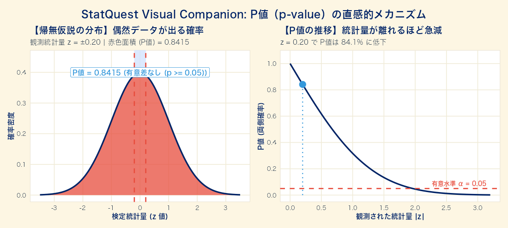

```{r setup, include=FALSE}
knitr::opts_chunk$set(
  echo = TRUE,
  warning = FALSE,
  message = FALSE,
  fig.width = 9,
  fig.height = 5,
  fig.align = "center",
  dev = "png",
  dpi = 150
)

suppressPackageStartupMessages({
  library(ggplot2)
  library(dplyr)
  library(tidyr)
  library(patchwork)
})

# プロジェクト共通の Solarized Light & Royal Blue テーマ
theme_statquest <- function() {
  theme_minimal(base_family = "Hiragino Sans") +
    theme(
      plot.background = element_rect(fill = "#fdf6e3", color = NA),
      panel.background = element_rect(fill = "#ffffff", color = "#e2d9c2"),
      panel.grid.major = element_line(color = "#f0ebd8"),
      panel.grid.minor = element_blank(),
      plot.title = element_text(color = "#002366", face = "bold", size = 15, hjust = 0),
      plot.subtitle = element_text(color = "#34495e", size = 11, hjust = 0, margin = margin(b = 10)),
      plot.caption = element_text(color = "#7f8c8d", size = 9),
      axis.title = element_text(color = "#002366", face = "bold", size = 11),
      axis.text = element_text(color = "#2c3e50", size = 10),
      strip.background = element_rect(fill = "#e8f0fe", color = "#002366"),
      strip.text = element_text(color = "#002366", face = "bold", size = 11),
      legend.position = "top",
      legend.background = element_rect(fill = "#fdf6e3", color = NA),
      legend.title = element_text(color = "#002366", face = "bold", size = 10),
      legend.text = element_text(color = "#2c3e50", size = 10)
    )
}

theme_set(theme_statquest())
```

## はじめに：なぜ「P値」は統計学最大の難所なのか？

統計学やデータ分析を学び始めて、誰もが一度は混乱するのが**「P値（p-value）」**です。

論文や実務の分析レポートでは「$p < 0.05$ だから統計的に有意である」という決まり文句が飛び交いますが、**「では、P値とは何ですか？」**と問われると、多くの人が口ごもってしまいます。

::: {.callout-important appearance="simple"}
### 🧭 核心となる一言要約（Bam!）
**P値とは、「もし仮に何の差も効果もない（すべてが単なる偶然である）世界」において、手元のデータ（またはそれ以上に極端なデータ）が偶然得られてしまう確率**のことです。

$$\text{P値} = P(\text{観測データ、またはそれ以上に極端なデータ} \mid \text{帰無仮説 } H_0 \text{ が真})$$
:::

日常の感覚で言えば、**「偶然だと言い張るには、どれくらい無理があるか？（どれくらい奇跡的な珍事か？）」**をパーセンテージで表した指標と言えます。

---

## P値を理解する「3つのステップ」

StatQuestの解説でおなじみの思考ステップで、P値の導出プロセスを整理しましょう。

```
【ステップ 1】「差がない世界（帰無仮説）」を仮定する
               ↓
【ステップ 2】その世界で、手元のデータが出る確率分布を考える
               ↓
【ステップ 3】手元のデータ、および「それ以上に極端な領域」の面積（確率）を合算する  ==> これが P値！
```

### 1. 帰無仮説（Null Hypothesis: $H_0$）
「何も起きていない」「新薬も偽薬も効果は同じ」「コインは歪んでいない（$p=0.5$）」という**退屈な世界**の仮定です。

### 2. 「手元のデータ」をその世界にプロットする
帰無仮説が正しいとしたら、どんなデータが普通で、どんなデータが珍しいのかを確率分布（正規分布、t分布、二項分布など）で描きます。

### 3. 「それ以上に極端（as extreme or more extreme）」を足す
なぜ「観測データそのものの確率」ではなく**「それ以上極端なもの」**を足すのでしょうか？
連続型データでは一点の確率は常にゼロ（$P(X=x)=0$）ですし、離散型でも「より疑わしい証拠」を含めて裾野全体の面積を測らないと、客観的な判定基準にならないためです。

---

## 決定的な比較表：よくある誤解 vs 統計学の真実

P値には、専門家ですら陥りやすい代表的な**「3大誤解」**があります。

| よくある誤解（❌） | 統計学の真実（⭕） | 理由・解説 |
| :--- | :--- | :--- |
| **誤解 1**: 「P値は、仮説が正しい確率である」 | **P値は、帰無仮説が正しいと仮定したもとでデータが得られる確率**である | $P(H_0 \mid \text{データ})$ ではなく、$P(\text{データ} \mid H_0)$ です（条件付き確率の前後が逆）。 |
| **誤解 2**: 「P値が小さいほど、効果が大きい」 | **P値は効果の大きさ（Effect Size）ではない** | サンプルサイズ $N$ が数万〜数百万と極端に大きい場合、ごくわずかな無意味な差でも P値 は $0.0001$ 以下になります。 |
| **誤解 3**: 「$p > 0.05$ だから、差がないことが証明された」 | **「差がない」と断定する証拠が不十分なだけ**（無罪推定） | 「犯人である証拠が見つからなかった」からといって「無実が完全に証明された」わけではないのと同じです。 |

::: {.callout-warning}
### ⚠️ 条件付き確率の取り違え（検察官の誤謬）
「容疑者が無実（帰無仮説）なら、犯行現場に指紋が一致する確率は $0.001$ だ（P値）」からといって、
「容疑者が無実である確率が $0.001$（$0.1\%$）である」と結論づけるのは数学的誤りです。
P値は**「前提（$H_0$）のもとでのデータの珍しさ」**であり、**「前提そのものの確かさ」**ではありません。
:::

---

## 動的ビジュアライゼーション（gganimate による直感理解）

検定統計量（$z$ や $t$）が中心から離れるにつれて、P値がどのように収縮し、判定が「有意差なし」から「統計的有意（Reject $H_0$）」へ変わるかをアニメーションで体感してみましょう。

- **左側【帰無仮説の確率分布】**: 統計量 $z$ が $0 \to 3$ へと離れるにつれ、両側の赤い裾野面積（P値）が急速に狭まっていきます。
- **右側【P値の減少曲線】**: 統計量 $z$ と P値 の関係を描いた曲線です。赤い点が 有意水準 $\alpha = 0.05$（点線）を下回った瞬間に「統計的有意（Bam!）」と判定が切り替わります。



#### アニメーションからわかる決定的なポイント
1. **P値は「赤色の面積」そのもの**:
   左側の正規分布で、観測値より外側にある赤い領域の合計が、右側プロットの縦軸（P値）と完全に一致しています。
2. **中心付近（$z \approx 0$）**:
   データが平均近くにあるときは $P \approx 1.0$ であり、「偶然で普通に起こる範囲」です。
3. **境界線（$z \approx 1.96$）の突破**:
   $z$ が $1.96$ を超えると赤い面積が $5\%$（$0.05$）未満となり、「偶然とは考えにくい」として帰無仮説を棄却します。

---

## 具体例 1：イカサマコインの検証（離散型：二項検定）

まずは身近なコイン投げで直感をつかみましょう。

友人が「このコインは表がよく出る特別なコインだ」と言い、**10回投げて8回表**が出ました。
このコインは本当にイカサマ（表が出やすい）なのでしょうか？

### 1. 仮説の設定
- **帰無仮説 $H_0$**: コインは公平である（表が出る確率 $p = 0.5$）
- **対立仮説 $H_1$**: コインは表が出やすい（片側検定: $p > 0.5$）

### 2. 公平なコインを10回投げたときの確率分布（Rコード）

```{r coin-plot}
# 10回投げて表が出る回数 k (0〜10)
n <- 10
p_null <- 0.5
k_vals <- 0:n

# 各回数の確率を計算
df_coin <- data.frame(
  k = k_vals,
  prob = dbinom(k_vals, size = n, prob = p_null)
) %>%
  mutate(
    category = case_when(
      k >= 8 ~ "観測値 (8回) 以上 [P値の領域]",
      TRUE   ~ "帰無仮説で想定される通常の範囲"
    )
  )

# プロット作成
ggplot(df_coin, aes(x = factor(k), y = prob, fill = category)) +
  geom_col(width = 0.7, color = "#002366", alpha = 0.85) +
  geom_text(aes(label = sprintf("%.3f", prob)), vjust = -0.5, size = 3.5, family = "Hiragino Sans") +
  scale_fill_manual(
    values = c(
      "観測値 (8回) 以上 [P値の領域]" = "#e74c3c",
      "帰無仮説で想定される通常の範囲" = "#3498db"
    )
  ) +
  scale_y_continuous(labels = scales::percent_format(accuracy = 1), limits = c(0, 0.30)) +
  labs(
    title = "公平なコイン（p = 0.5）を10回投げたときの表の回数分布",
    subtitle = "赤色の棒の合計が「8回以上表が出る確率（片側P値）」を表す",
    x = "表が出た回数 (k)",
    y = "発生確率",
    fill = ""
  )
```

### 3. P値の計算

表が8回以上（8回、9回、10回）出る確率の合計を計算します。

```{r coin-calc}
# 表が8回、9回、10回出る確率
prob_8  <- dbinom(8, size = 10, prob = 0.5)
prob_9  <- dbinom(9, size = 10, prob = 0.5)
prob_10 <- dbinom(10, size = 10, prob = 0.5)

# 合計（片側P値）
p_val_onesided <- prob_8 + prob_9 + prob_10

cat(sprintf("P(X = 8)  = %.4f (約 %.2f%%)\n", prob_8, prob_8 * 100))
cat(sprintf("P(X = 9)  = %.4f (約 %.2f%%)\n", prob_9, prob_9 * 100))
cat(sprintf("P(X = 10) = %.4f (約 %.2f%%)\n", prob_10, prob_10 * 100))
cat(sprintf("----------------------------------------\n"))
cat(sprintf("片側 P値 (8回以上) = %.4f (約 %.2f%%)\n", p_val_onesided, p_val_onesided * 100))

# binom.test() 関数による検定
binom_res <- binom.test(x = 8, n = 10, p = 0.5, alternative = "greater")
cat(sprintf("binom.test() の片側 P値: %.4f\n", binom_res$p.value))
```

::: {.callout-note}
### 💡 この結果をどう解釈するか？
- 公平なコインであっても、10回投げれば**約 5.47% の確率でたまたま8回以上表が出る**ことがあります。
- もし慣例的な基準（有意水準 $\alpha = 0.05 = 5\%$）を採用するならば、$0.0547 > 0.05$ であるため、**「偶然でも起こりうる範囲内であり、イカサマとまでは断定できない」**という結論になります。
:::

---

## 具体例 2：新薬の臨床試験（連続型：2標本 t検定）

次に、実務で最も頻出する「2つのグループの平均値の差」を検証する **2標本 t検定（Student's t-test）** を見てみましょう。

### シナリオ
- 新しい降圧薬（グループA: 30名）と プラセボ（偽薬、グループB: 30名）の血圧低下量を測定。
- グループAの平均低下量: $12.4 \text{ mmHg}$
- グループBの平均低下量: $8.1 \text{ mmHg}$
- 見かけ上、$4.3 \text{ mmHg}$ の差があります。これは薬の真の効果でしょうか？それとも単なる患者の個体差（偶然）でしょうか？

```{r ttest-sim}
set.seed(123)

# 模擬データの生成
n_group <- 30
group_a <- rnorm(n_group, mean = 12.4, sd = 6.0) # 新薬群
group_b <- rnorm(n_group, mean = 8.1,  sd = 6.0) # プラセボ群

df_patients <- data.frame(
  group = rep(c("新薬群 (Drug A)", "プラセボ群 (Placebo B)"), each = n_group),
  reduction = c(group_a, group_b)
)

# 2群の要約統計量
df_patients %>%
  group_by(group) %>%
  summarise(
    人数 = n(),
    標本平均 = mean(reduction),
    標本標準偏差 = sd(reduction)
  )
```

### t検定の実行

```{r ttest-run}
# Student の 2標本 t検定 (等分散を仮定)
t_res <- t.test(group_a, group_b, var.equal = TRUE)
print(t_res)

obs_t <- t_res$statistic # 観測された t 値
df_val <- t_res$parameter # 自由度 (30 + 30 - 2 = 58)
p_value <- t_res$p.value  # P値
```

### t分布上で「P値」の領域を可視化する

t検定における P値 は、**「差がない（$\mu_A - \mu_B = 0$）としたときの t分布」**において、観測された t値 より外側の裾野の面積（両側検定なら左右両方）です。

```{r t-distribution-plot}
# t分布の曲線データ作成
x_vals <- seq(-4, 4, length.out = 1000)
df_tdist <- data.frame(
  x = x_vals,
  density = dt(x_vals, df = df_val)
)

ggplot(df_tdist, aes(x = x, y = density)) +
  # 全体の t 分布曲線
  geom_line(color = "#002366", linewidth = 1.2) +
  
  # 右側の棄却・P値領域 (t >= |obs_t|)
  geom_area(
    data = filter(df_tdist, x >= abs(obs_t)),
    fill = "#e74c3c", alpha = 0.7
  ) +
  # 左側の棄却・P値領域 (t <= -|obs_t|)
  geom_area(
    data = filter(df_tdist, x <= -abs(obs_t)),
    fill = "#e74c3c", alpha = 0.7
  ) +
  
  # 観測された t 値の縦線
  geom_vline(xintercept = c(-abs(obs_t), abs(obs_t)), linetype = "dashed", color = "#e74c3c", linewidth = 0.8) +
  
  # 注釈アノテーション
  annotate(
    "text", x = abs(obs_t) + 0.4, y = 0.15,
    label = sprintf("観測された t値 = +%.2f\n(右側の面積 = P/2)", obs_t),
    color = "#e74c3c", fontface = "bold", hjust = 0, family = "Hiragino Sans"
  ) +
  annotate(
    "text", x = -abs(obs_t) - 0.4, y = 0.15,
    label = sprintf("対称な t値 = -%.2f\n(左側の面積 = P/2)", obs_t),
    color = "#e74c3c", fontface = "bold", hjust = 1, family = "Hiragino Sans"
  ) +
  annotate(
    "label", x = 0, y = 0.25,
    label = sprintf("両側の赤色面積の合計 (P値) = %.4f\n(偶然これほど離れる確率: 約 %.2f%%)", p_value, p_value * 100),
    fill = "#fdf6e3", color = "#002366", fontface = "bold", family = "Hiragino Sans"
  ) +
  labs(
    title = sprintf("帰無仮説のもとでの t分布 (自由度 df = %d) と P値の可視化", as.integer(df_val)),
    subtitle = "赤色に塗られた両側の裾野の面積の合計が、計算された P値 です",
    x = "t 値 (平均値の差を標準誤差で割った指標)",
    y = "確率密度"
  )
```

このグラフから直感的に理解できます。
- 山の中央（$t = 0$ 付近）は、「両グループに差がない世界」で普通に起きる結果です。
- 観測された $t \approx `r round(obs_t, 2)`$ は山の中央から大きく離れており、両端の赤い面積（P値）はわずか **約 `r round(p_value * 100, 2)`%** しかありません。
- したがって、「偶然でこの差が出た」と考えるのは非常に不自然であり、新薬には確かな効果があると判断（帰無仮説を棄却）します。

---

## 具体例 3：モンテカルロ・シミュレーションで体感する「差がない世界」

数式や t分布 の定義が抽象的に感じる方のために、**「差がない世界」をコンピュータの中で 10,000 回実際に創り出すシミュレーション**を行ってみましょう！

### シミュレーションの手順
1. **「完全に差がない世界」のデータ**：全員に同じ平均値（効果なし）の薬を与えたと仮定し、乱数を 10,000 回生成します。
2. 毎回、2グループの平均の差を計算して記録します。
3. 10,000 回中、手元で観測された差（例: $+3.5\text{ mmHg}$ 以上、または $-3.5\text{ mmHg}$ 以下）が何回発生するか数えます。

```{r monte-carlo}
set.seed(42)
n_sims <- 10000
n_per_group <- 30
observed_diff <- 3.5 # 手元で観測された平均の差 (mmHg)

# 差がない世界 (平均 10, 標準偏差 6 で全員同じ)
simulated_diffs <- numeric(n_sims)

for (i in 1:n_sims) {
  # 差がない世界から 30名ずつランダム抽出
  sample_1 <- rnorm(n_per_group, mean = 10, sd = 6)
  sample_2 <- rnorm(n_per_group, mean = 10, sd = 6)
  
  # 2群の平均の差を記録
  simulated_diffs[i] <- mean(sample_1) - mean(sample_2)
}

# 観測された差 (|diff| >= 3.5) 以上に極端だった回数をカウント
extreme_count <- sum(abs(simulated_diffs) >= observed_diff)
simulated_p_value <- extreme_count / n_sims

cat(sprintf("シミュレーション総回数: %d 回\n", n_sims))
cat(sprintf("差がない世界で偶然 |差| >= %.1f となった回数: %d 回\n", observed_diff, extreme_count))
cat(sprintf("シミュレーションによる P値: %.4f (約 %.2f%%)\n", simulated_p_value, simulated_p_value * 100))
```

### シミュレーション結果のヒストグラム

```{r monte-carlo-plot}
df_sim <- data.frame(diff = simulated_diffs) %>%
  mutate(is_extreme = abs(diff) >= observed_diff)

ggplot(df_sim, aes(x = diff, fill = is_extreme)) +
  geom_histogram(binwidth = 0.3, color = "#ffffff", alpha = 0.85) +
  geom_vline(xintercept = c(-observed_diff, observed_diff), linetype = "dashed", color = "#e74c3c", linewidth = 1) +
  scale_fill_manual(
    values = c("FALSE" = "#3498db", "TRUE" = "#e74c3c"),
    labels = c("偶然の範囲内の差", sprintf("|差| >= %.1f (極端な結果)", observed_diff))
  ) +
  annotate(
    "label", x = observed_diff + 0.5, y = 600,
    label = sprintf("観測された差 = +%.1f\nこの外側の割合が P値", observed_diff),
    color = "#e74c3c", fontface = "bold", hjust = 0, family = "Hiragino Sans", fill = "#fdf6e3"
  ) +
  labs(
    title = "「差がない世界」を10,000回シミュレーションしたときの平均値の差",
    subtitle = sprintf("赤色部分の割合 = %d / 10,000 = %.2f%% (これが P値 の正体！)", extreme_count, simulated_p_value * 100),
    x = "2群の平均値の差 (グループ1 - グループ2)",
    y = "シミュレーションで発生した頻度 (回)",
    fill = ""
  )
```

::: {.callout-tip}
### 🎯 これぞ P値 の本質！
「P値」とは、難解な積分記号や分布表の向こう側にあるものではなく、**「差がない世界でサイコロを10,000回振ったとき、たまたまこれくらい極端な結果が出てしまう割合」**そのものです！
:::

---

## なぜ有意水準は「0.05」なのか？

歴史的に、近代統計学の父 **ロナルド・フィッシャー（Ronald Fisher）** が1925年の著書『研究者のための統計的方法』で「20回に1回（$5\% = 0.05$）起こる程度の珍しさを目安にしてはどうか」と例示したのが広まり、国際的な慣例となりました。

- **有意水準 $\alpha = 0.05$**: 「偶然で起こる確率が $5\%$ 未満なら、偶然とは考えにくく、効果があると判定しよう」
- **第1種の過誤（Type I Error / 偽陽性）**: 「本当は何の差もないのに、たまたま $5\%$ のレアケースを引いて『効果あり』と誤判定してしまうリスク」がまさに $\alpha$ です。

::: {.callout-note}
### 近年の統計学の動向：P値ハッキングへの警鐘
アメリカ統計学会（ASA）は2016年に「P値に関する声明」を出し、**「$p < 0.05$ かどうかという機械的な二者択一のみで研究の真偽を判断してはならない」**と強く警告しました。
P値だけでなく、**効果量（Effect Size）**や**信頼区間（Confidence Interval）**を併せて報告することが強く推奨されています。
:::

---

## 理解度チェッククイズ（全3問）

理解を確実にするためのセルフチェックです。クリックして正解と解説を確認してください。

::: {.callout-caution collapse="true"}
### ❓ 第1問：P値の定義
新薬の臨床試験で「血圧降下効果あり、P値 = 0.03」という結果が得られました。この「0.03」の正しい意味は次のうちどれでしょう？

A. 新薬が効く確率が $97\%$ である。  
B. 新薬に効果がない（偽薬と同じ）確率が $3\%$ である。  
C. もし新薬に全く効果がないとしたら、今回のデータほど大きな差が偶然生じる確率が $3\%$ である。  
D. 実験を100回繰り返したとき、3回は失敗することを意味する。  

<details>
<summary>👉 正解と解説を見る</summary>
**正解: C**

**解説:**  
P値は「帰無仮説（効果がない）が正しいと仮定したとき」に、観測データ以上の極端な結果が偶然生じる確率です。
AやBは「仮説そのものが正しい確率」と混同しており、ベイズ統計学における事後確率でなければ語れません。
</details>
:::

::: {.callout-caution collapse="true"}
### ❓ 第2問：サンプルサイズとP値
あるウェブサイトのABテストで、ボタンの色を青から緑に変更したところ、購入率が $2.00\%$ から $2.01\%$ へわずか $0.01\%$ 上昇しました。しかし、アクセス数が1,000万人と膨大だったため、検定結果は $p = 0.0001$ となりました。どう解釈すべきでしょうか？

A. P値が極めて小さいので、ボタンの色を緑に変えると劇的な売上増加が見込める。  
B. 統計的には「差がある（偶然ではない）」と確認できたが、効果の大きさ（$0.01\%$）が実務的に価値あるものかはビジネス上の判断が必要である。  
C. P値が小さいのだから、売上への影響度も極めて大きいと断言できる。  

<details>
<summary>👉 正解と解説を見る</summary>
**正解: B**

**解説:**  
サンプルサイズ $N$ が非常に大きい場合、実質的にはどうでもいい微小な差であっても P値 は $0.0001$ など極小になります。「統計的に有意であること（Statistical Significance）」と「実質的に意味があること（Practical / Clinical Significance）」は全く別物です。
</details>
:::

::: {.callout-caution collapse="true"}
### ❓ 第3問：p > 0.05 だったときの結論
新しい学習アプリの効果を検証したところ、$p = 0.18$ でした（有意水準 $\alpha = 0.05$）。このとき導くべき正しい結論はどれでしょう？

A. この学習アプリには効果が全くないことが科学的に証明された。  
B. 従来の勉強法と学習アプリの効果は完全に同一である。  
C. 今回の実験データからは、「アプリに効果がある」と主張するための十分な証拠が得られなかった（効果がないと断定することはできない）。  

<details>
<summary>👉 正解と解説を見る</summary>
**正解: C**

**解説:**  
帰無仮説が棄却できなかった場合（$p > 0.05$）、「帰無仮説が正しい」と証明されたわけではありません。単に「サンプル数が足りなかった（検出力不足）」か「効果が小さかった」ために、偶然のバラツキと区別がつかなかっただけです。「証拠の不在は、不在の証拠にあらず（Absence of evidence is not evidence of absence）」という格言が有名です。
</details>
:::

---

## まとめ

1. **P値の本質**:
   「何の差もない世界（帰無仮説）」において、手元のデータ以上の極端な事象が偶然起きてしまう確率。
2. **直感イメージ**:
   「偶然だと言い張るには、どれくらい苦しいか？」を示すバロメーター。P値が小さいほど「偶然とは考えにくい」ため、効果の存在を認める。
3. **忘れてはならない注意点**:
   - P値は「仮説が正しい確率」ではない。
   - P値は「効果の大きさ」ではない（サンプルサイズに左右される）。
   - 有意差が出なくても「差がないことが証明された」わけではない。
   - 信頼区間や効果量とセットで評価することが現代統計学の鉄則！
